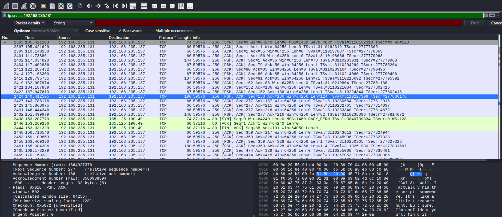
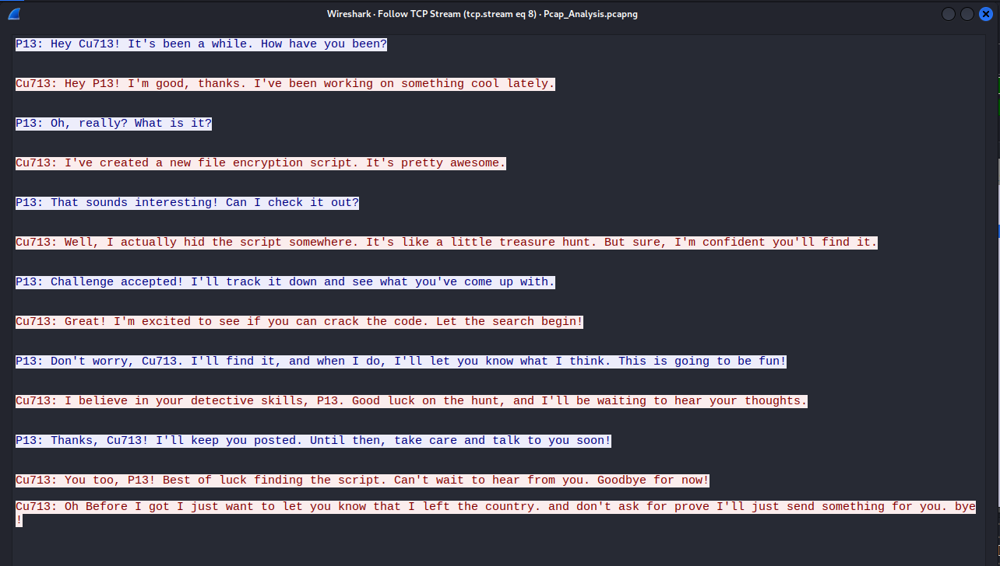
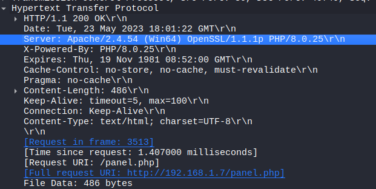
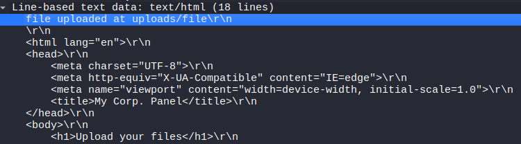
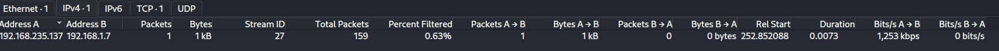

### Description
We have captured this traffic from P13’s computer. Can you help him?

### Analysis
The file captures a lot of traffic. I decided to check if there was any HTTP traffic to read any communications, and I hit 10.

I also found a chat that P13 and cu713 used to communicate.

Task 1. In network communication, what are the IP addresses of the sender and receiver?
192.168.235.137,192.168.235.131

Task 2. P13 uploaded a file to the web server. What is the IP address of the server?
192.168.1.7

Task 3. What is the name of the file that was sent through the network?
file

Task 4. What web server software is running on the target machine?
Apache

Task 5. What directory was the file uploaded to?
uploads

Task 6. How long did it take the sender to send the encrypted file?
0.0073

